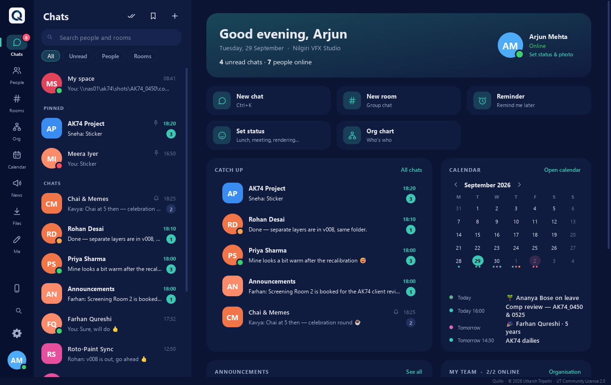
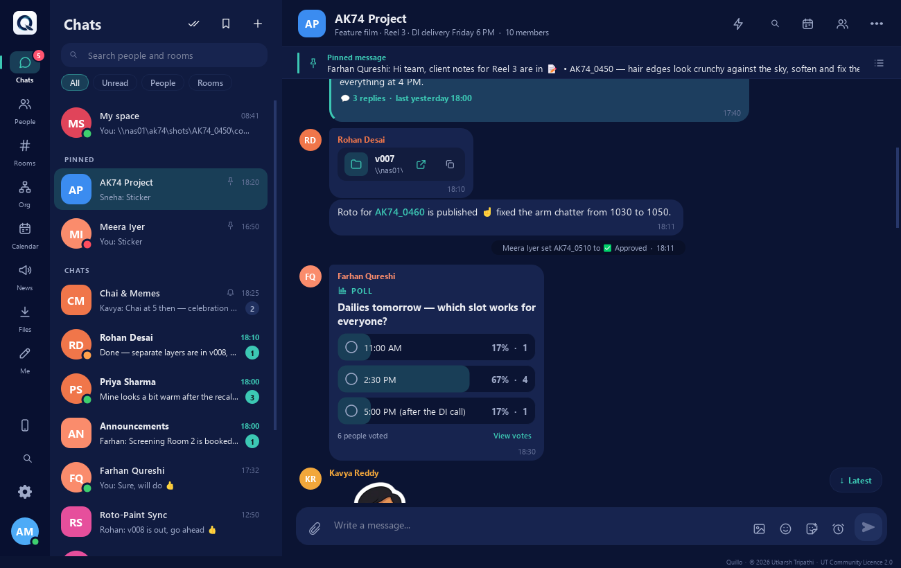
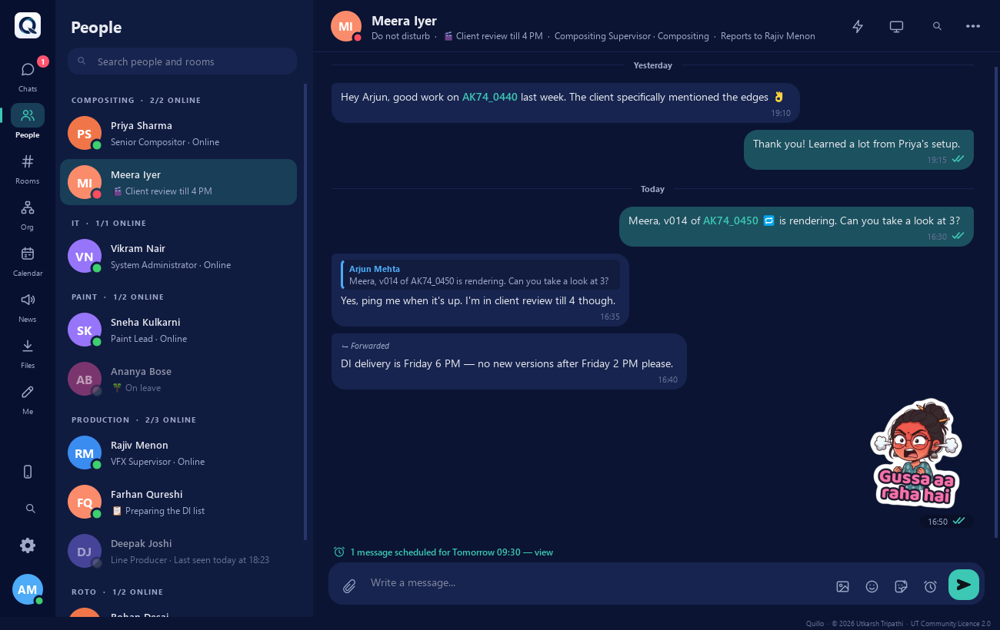
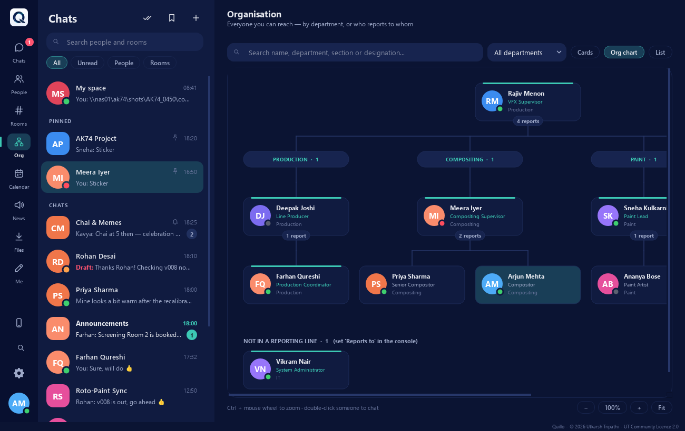
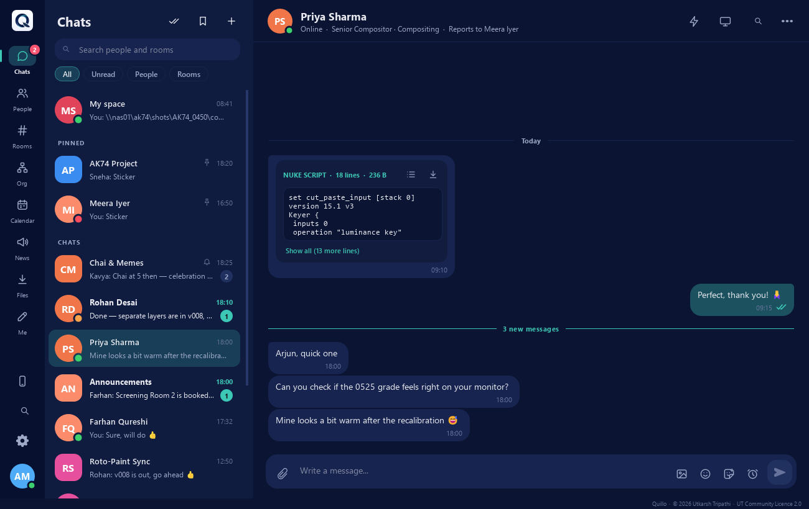

# Quillo

A private LAN messenger for VFX and animation studios: chat, file sharing and rooms on your own network, with no internet needed.

## Download

Get the latest setup from **[Releases](https://github.com/capsuleutkarsh-design/Quillo/releases/latest)**. Download every file of the release into one folder, then run the `.exe`.

Website and guide: https://capsuleutkarsh-design.github.io/studio-lan-messenger/

## Screenshots

**Home**

**Chat**

**People**

**Org chart**

**Sharing a Nuke script**

## Licence

Quillo is free to use, made by Utkarsh Tripathi. It is not for sale. Please do not re-upload the setup or remove the author's name. The full licence is shown in the installer.

Questions and bug reports: [capsuleutkarsh@gmail.com](mailto:capsuleutkarsh@gmail.com)
